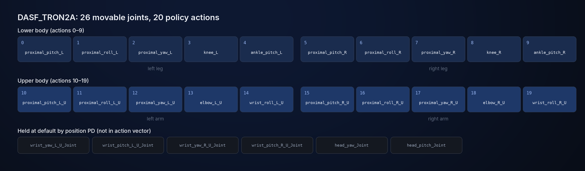
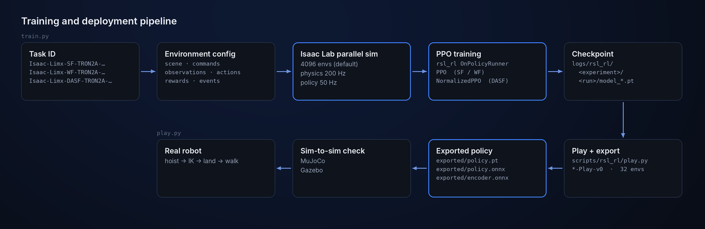
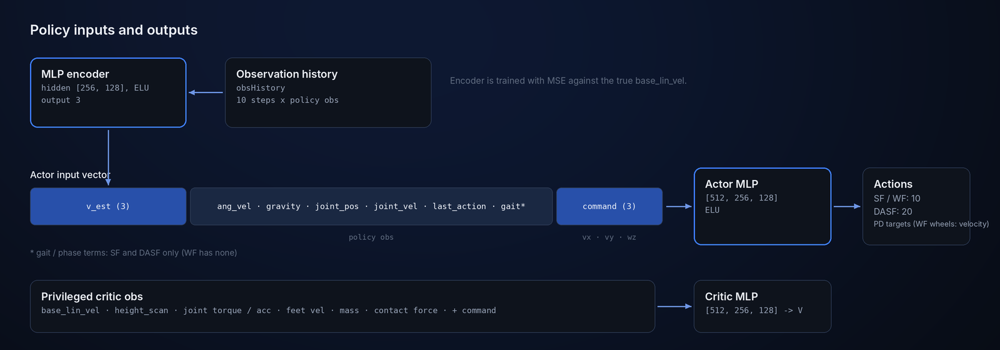
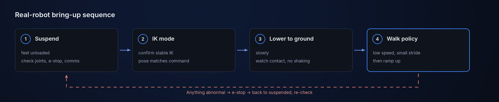

<!--
  SPDX-FileCopyrightText: 2024-2026 LimX Dynamics Technology Co., Ltd.
  SPDX-License-Identifier: Apache-2.0
-->

<p align="center">
  
</p>

<p align="center">
  <a href="README.md">English</a> | <a href="README_zh-CN.md">中文</a>
</p>

<p align="center">
  <a href="LICENSE"></a>
  
  
  
</p>

# tron2_rl_lab

Reinforcement learning training stack for the LimX **TRON2A** bipedal
robot, built on top of
[Isaac Lab](https://isaac-sim.github.io/IsaacLab/) and using PPO to
train locomotion policies. This repository focuses on flat-terrain
training and supports the **SF** (sole-foot), **WF** (wheel-foot), and
**DASF_TRON2A** full-body variants. DASF_TRON2A combines the sole-foot
lower body with two arms and a head.

> **Scope:** flat-terrain, blind (no perception) velocity tracking.
> Trained policies are not included; you train them here and export
> TorchScript / ONNX for deployment.

## Highlights

- **Three morphologies, one stack.** Sole-foot, wheel-foot and the
  full-body dual-arm DASF_TRON2A each register a training task and a
  `-Play-v0` task.
- **Whole-body policy for DASF_TRON2A.** 20 position actions drive both
  legs and both arms, with arm-swing and foot–arm coordination rewards;
  wrists and head are held by PD.
- **Built-in velocity estimator.** An MLP encoder reads 10 steps of
  observation history and estimates base linear velocity, trained
  against the simulator's ground truth.
- **Deployment-ready export.** `play.py` writes TorchScript
  (`policy.pt`) and ONNX (`policy.onnx`, `encoder.onnx`) next to the
  checkpoint; the results in MuJoCo, Gazebo and on the real TRON2A are
  shown below.

## Model lineup

| | Model | Description | DoF | Formats |
|:---:|---|---|:---:|---|
|  | **SF_TRON2A** | Biped with sole feet (ankle pitch). 10 position actions.<br>`Isaac-Limx-SF-TRON2A-Blind-Flat-v0` | 10 | USD · URDF · Xacro · MJCF |
|  | **WF_TRON2A** | Biped with wheel feet. 8 leg joints in position control, 2 wheels in velocity control.<br>`Isaac-Limx-WF-TRON2A-Blind-Flat-v0` | 10 | USD · URDF · Xacro · MJCF |
|  | **DASF_TRON2A** | SF lower body + two arms + head. 20 position actions; 6 wrist / head joints held by PD.<br>`Isaac-Limx-DASF-TRON2A-Blind-Flat-v0` | 26 | USD · URDF · Xacro · MJCF |

Images are rendered in MuJoCo from each variant's bundled robot model
(`exts/bipedal_locomotion/bipedal_locomotion/assets/usd/<MODEL>/`), same
camera and lighting for all three. Each task also has a `-Play-v0`
variant (for example `Isaac-Limx-SF-TRON2A-Blind-Flat-Play-v0`).

The DASF_TRON2A action vector concatenates 10 lower-body and 10
upper-body joint targets in a fixed order; real-robot deployment must
use the same order. See also the
[DASF_TRON2A task details](exts/bipedal_locomotion/bipedal_locomotion/tasks/locomotion/cfg/DASF_TRON2A/README.md).

<p align="center">
  
</p>

## Results on the real robot and in simulation

**Real TRON2A** (SF / WF / DASF_TRON2A, office scene):

<p align="center">
  
  
  
</p>

**MuJoCo** (SF / WF / DASF_TRON2A):

<p align="center">
  
  
  
</p>

**Gazebo** (SF / WF):

<p align="center">
  
  
</p>

## How it works

<p align="center">
  
</p>

A task ID selects an environment config and a PPO config. Isaac Lab
steps thousands of environments in parallel (physics at 200 Hz, policy
at 50 Hz), `rsl_rl` trains the policy, and `play.py` exports it for
sim-to-sim checks and real-robot deployment.

<p align="center">
  
</p>

The actor sees only proprioception, the velocity command and the
encoder's base-velocity estimate. The critic additionally receives
privileged simulator state (true base velocity, height scan, joint
torques, contact forces, mass), which is available only during
training.

## Quick start

**Look at the robots in 30 seconds** (no Isaac Sim needed):

```bash
git clone https://github.com/limxdynamics/tron2_rl_lab.git
cd tron2_rl_lab
git lfs pull   # DASF_TRON2A meshes are stored with Git LFS
pip install mujoco
python -m mujoco.viewer --mjcf=exts/bipedal_locomotion/bipedal_locomotion/assets/usd/DASF_TRON2A/xml/robot.xml
```

Swap `DASF_TRON2A` for `WF_TRON2A` to view the wheel-foot model.

**Train a policy** (Isaac Sim 5.1 + Isaac Lab 2.3.1 installed, see
[Installation](#installation)):

```bash
python scripts/rsl_rl/train.py --task Isaac-Limx-SF-TRON2A-Blind-Flat-v0 --num_envs 4096 --headless
```

## Installation

Requirements:

- **Isaac Sim 5.1** + **Isaac Lab 2.3.1**, obtained from NVIDIA (see
  [Scope](#scope))
- Python 3.10
- A CUDA-capable GPU (≥ 12 GB VRAM recommended for 4096-env training)

```bash
# 1. Clone the repository
git clone https://github.com/limxdynamics/tron2_rl_lab.git tron2_rl_lab
cd tron2_rl_lab

# 2. Editable install of the extension and the vendored rsl_rl
pip install -e exts/bipedal_locomotion
pip install -e rsl_rl
```

## Training, play and resume

Replace `<TASK>` with a task ID from the [Model lineup](#model-lineup).
Task IDs are registered in
[exts/bipedal_locomotion/bipedal_locomotion/tasks/locomotion/robots/__init__.py](exts/bipedal_locomotion/bipedal_locomotion/tasks/locomotion/robots/__init__.py).

**Train:**

```bash
python scripts/rsl_rl/train.py --task <TASK> --num_envs 4096 --headless
```

Options: `--video` records videos, `--max_iterations N` overrides the
maximum number of iterations. Logs and checkpoints go to
`logs/rsl_rl/<experiment_name>/<timestamp>_<run_name>/`.

**Play and export:** use the task ID with the `-Play-v0` suffix. The
play cfg uses fewer envs, disables domain randomization, and simplifies
the terrain.

```bash
python scripts/rsl_rl/play.py --task <TASK-with-Play-v0> --num_envs 32
```

By default the latest checkpoint is loaded; pass
`--checkpoint_path <path_to_model.pt>` to select a specific one. Play
also exports the loaded policy to an `exported/` folder next to the
checkpoint: `policy.pt` (TorchScript), `policy.onnx` and
`encoder.onnx`. For DASF_TRON2A the exported actor includes its
observation normalizer.

**Resume:** `--resume True` must be passed explicitly for a checkpoint
to be loaded. Point at a `.pt` file (recommended) or look up a run by
name:

```bash
python scripts/rsl_rl/train.py --task <TASK> --resume True --checkpoint_path <path_to_model.pt>
python scripts/rsl_rl/train.py --task <TASK> --resume True --load_run <run_name>
```

## Repository layout and task wiring

```
.
├── exts/bipedal_locomotion/   # Isaac Lab extension: env / asset / MDP / robot cfg,
│                              # robot models under bipedal_locomotion/assets/usd/
├── rsl_rl/                    # vendored rsl_rl fork (PPO + on-policy runner);
│                              # scripts/rsl_rl/train.py prefers it over a pip install
├── scripts/rsl_rl/            # training / play entry points (train.py / play.py / cli_args.py)
├── doc/                       # README images and MuJoCo / Gazebo / real-robot GIFs
└── logs/                      # training logs and model weights (not committed)
```

How a task ID is wired:

1. **Gym registration**: in `tasks/locomotion/robots/__init__.py`,
   the environment configuration and PPO configuration are bound to
   the task ID.
2. **Env cfg**: SF/WF use `tasks/locomotion/robots/limx_solefoot_tron2a_env_cfg.py`
   and `tasks/locomotion/robots/limx_wheelfoot_tron2a_env_cfg.py`
   respectively; DASF_TRON2A is assembled by
   `tasks/locomotion/robots/limx_dasf_tron2a_env_cfg.py`.
3. **Asset cfg**: SF/WF use `assets/config/solefoot_tron2a_cfg.py` /
   `assets/config/wheelfoot_tron2a_cfg.py`; DASF_TRON2A uses
   `assets/config/dasf_tron2a_cfg.py` for its independent USD and
   actuator parameters.
4. **DASF_TRON2A MDP**: scene, observation, event, curriculum, and
   reward implementations live under `tasks/locomotion/cfg/DASF_TRON2A/`.
5. **DASF_TRON2A agent**:
   `tasks/locomotion/agents/dasf_rsl_rl_ppo_cfg.py` selects
   `NormalizedPPO`, a history encoder, and independent actor/critic
   observation normalization.

## Sim-to-sim and real-robot deployment

| | Simulation | Real-robot deployment |
|---|---|---|
| MuJoCo + Python | [tron2_mujoco_sim](https://github.com/limxdynamics/tron2_mujoco_sim) | [tron2_rl_deploy_python](https://github.com/limxdynamics/tron2_rl_deploy_python) |
| Gazebo + ROS (SF / WF) | [tron2_gazebo_ros](https://github.com/limxdynamics/tron2_gazebo_ros) | [tron2_rl_deploy_ros](https://github.com/limxdynamics/tron2_rl_deploy_ros) |

## Real-hardware operating notes (strongly recommended)

<p align="center">
  
</p>

Follow this fixed start-up and landing sequence to avoid impact
transients when switching policies:

1. **Suspend the robot** so that neither foot is loaded; check joint
   state, e-stop, and communication.
2. **Enter IK mode first** and confirm inverse-kinematics control is
   stable and the pose matches what you commanded.
3. **Slowly lower the robot to the ground**, watching for smooth
   contact and any abnormal shaking.
4. **Only then switch to the walk policy**, verifying at low speed
   and small stride before ramping up.

If anything abnormal happens (sudden shaking, pose divergence, hard
impact on landing), trigger the emergency stop immediately, return
to the suspended state, and re-check.

## Contributing

Local checks that match CI, and a short end-to-end smoke run, are in
[CONTRIBUTING.md](CONTRIBUTING.md#verification-before-opening-a-pr).

## Scope

**Not included** — by design:

- **No trained policies** (`*.pt`, `*.pth`, `*.ckpt`, `*.onnx`,
  `*.jit`). Train them yourself.
- **No training logs, TensorBoard events, or Weights & Biases runs.**
  `logs/`, `wandb/`, `events.out.tfevents.*` are `.gitignore`'d and
  CI-blocked.
- **No Isaac Sim redistribution.** You must obtain NVIDIA Isaac Sim
  5.1 independently and accept the NVIDIA proprietary EULA before
  installing this stack. Nothing here grants an Isaac Sim license.
- **No GPU / driver bundling.** This repo does not ship drivers, CUDA,
  or PyTorch wheels.
- **No SDK binaries, firmware, calibration values, customer
  configuration, or vendor CAD.**

## Reference

- [Isaac Lab](https://github.com/isaac-sim/IsaacLab)
- [RSL-RL](https://github.com/leggedrobotics/rsl_rl) — upstream of
  the vendored fork under [`rsl_rl/`](rsl_rl).

## License & attribution

This project is distributed under the **Apache License, Version 2.0**
(January 2004). The full text is in [`LICENSE`](LICENSE) at the root
of the repository. SPDX identifier: `Apache-2.0`.

- [`NOTICE`](NOTICE) — required attribution notice.
- [`THIRD_PARTY_NOTICES.md`](THIRD_PARTY_NOTICES.md) — per-component
  provenance: the Isaac Lab-derived extension, the vendored
  `rsl_rl/` fork (BSD-3-Clause), dev-tool license texts (including
  a GPL entry that must be classified before release), bundled
  STL / USD assets, and doc media.
- [`SECURITY.md`](SECURITY.md) — how to report a vulnerability or a
  safety-adjacent RL / reward / termination issue.
- [`CONTRIBUTING.md`](CONTRIBUTING.md) — dev setup, vendored-fork
  update policy, PR checklist, DCO sign-off.
- [`CHANGELOG.md`](CHANGELOG.md) — release notes and the currently
  outstanding **`⚠ TO CONFIRM`** items that block the first public
  tag.

Note on subtrees:

- `exts/bipedal_locomotion/setup.py` declares
  `license="Apache-2.0"`, aligned with the top-level LICENSE. The
  per-file Isaac-Lab-derivation audit is tracked separately as
  `⚠ TO CONFIRM` in `THIRD_PARTY_NOTICES.md` §1.
- `rsl_rl/` is a **vendored fork** of
  [`leggedrobotics/rsl_rl`](https://github.com/leggedrobotics/rsl_rl)
  under **BSD-3-Clause**; upstream copyright notices are retained
  (see `THIRD_PARTY_NOTICES.md` §2 and
  `CONTRIBUTING.md#vendored-rsl_rl-update-policy`).

For a summary of local modifications relative to upstream, see
[`CHANGES_VS_UPSTREAM.md`](rsl_rl/CHANGES_VS_UPSTREAM.md) and
[`licenses/dependencies/README.md`](rsl_rl/licenses/dependencies/README.md).

## Cite & support

If you use this training stack in academic or public work, please
cite the repository:

```
@misc{limx_tron2_rl_lab_2026,
  title  = {tron2_rl_lab: RL training stack for the LimX TRON2A bipedal robot},
  author = {LimX Dynamics},
  year   = {2026},
  howpublished = {\url{https://github.com/limxdynamics/tron2_rl_lab}}
}
```

- **Bug reports / feature requests:** [GitHub Issues](https://github.com/limxdynamics/tron2_rl_lab/issues).
- **Questions / integration help:** [GitHub Discussions](https://github.com/limxdynamics/tron2_rl_lab/discussions).
- **Security reports:** email `contact@limxdynamics.com`; see
  [`SECURITY.md`](SECURITY.md).
- **Hardware / real-robot safety incidents:** email
  `contact@limxdynamics.com` with subject prefix
  `[tron2_rl_lab hardware]`. Do not open a public issue.
- **Company / commercial contact:** <https://www.limxdynamics.com>.
