<!--
  SPDX-FileCopyrightText: 2024-2026 LimX Dynamics Technology Co., Ltd.
  SPDX-License-Identifier: Apache-2.0
-->

<p align="center">
  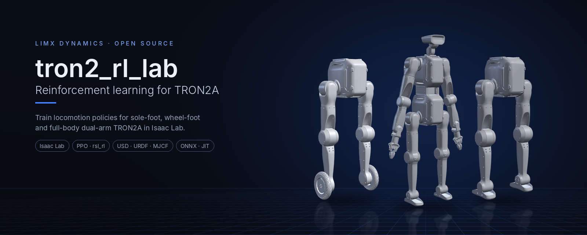
</p>

<p align="center">
  <a href="README.md">English</a> | <a href="README_zh-CN.md">中文</a>
</p>

<p align="center">
  <a href="LICENSE"></a>
  
  
  
</p>

# tron2_rl_lab

基于 [Isaac Lab](https://isaac-sim.github.io/IsaacLab/) 的 LimX **TRON2A**
强化学习训练栈，使用 PPO 训练 locomotion 策略。本仓库专注于平地
（Flat）训练，支持 SF（sole-foot）、WF（wheel-foot），以及由双足、
双臂和头部组成的 DASF_TRON2A 全身机器人。

> **适用范围：** 平地、无感知（Blind）的速度跟踪任务。仓库不附带训练好的
> 策略；在这里训练后可导出 TorchScript / ONNX 用于部署。

## 亮点

- **三种形态，一套训练栈。** 点足（sole-foot）、轮足（wheel-foot）和带双臂的
  全身 DASF_TRON2A 都注册了训练任务和 `-Play-v0` 任务。
- **DASF_TRON2A 全身策略。** 20 维位置动作同时控制双腿和双臂，带摆臂与脚臂
  协调奖励；手腕和头部由 PD 保持。
- **内置速度估计器。** MLP 编码器读取 10 步观测历史，估计机身线速度，并以
  仿真真值为监督训练。
- **导出即可部署。** `play.py` 在 checkpoint 旁导出 TorchScript
  （`policy.pt`）和 ONNX（`policy.onnx`、`encoder.onnx`）；在 MuJoCo、
  Gazebo 和 TRON2A 实机上的效果见下文。

## 型号一览

| | 型号 | 说明 | 自由度 | 格式 |
|:---:|---|---|:---:|---|
| 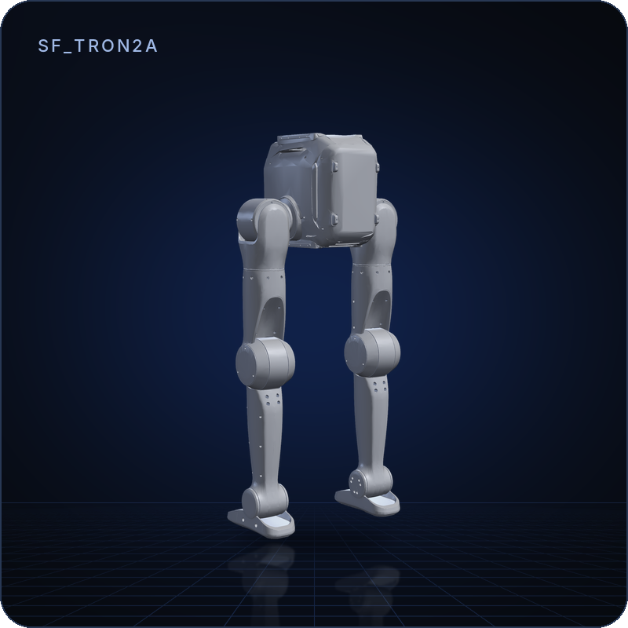 | **SF_TRON2A** | 点足双足（带 ankle pitch）。10 维位置动作。<br>`Isaac-Limx-SF-TRON2A-Blind-Flat-v0` | 10 | USD · URDF · Xacro · MJCF |
| 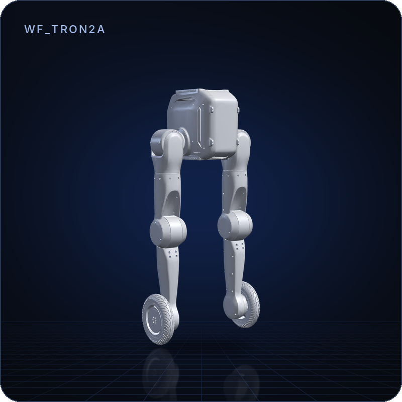 | **WF_TRON2A** | 轮足双足。8 个腿部关节为位置控制，2 个轮子为速度控制。<br>`Isaac-Limx-WF-TRON2A-Blind-Flat-v0` | 10 | USD · URDF · Xacro · MJCF |
| 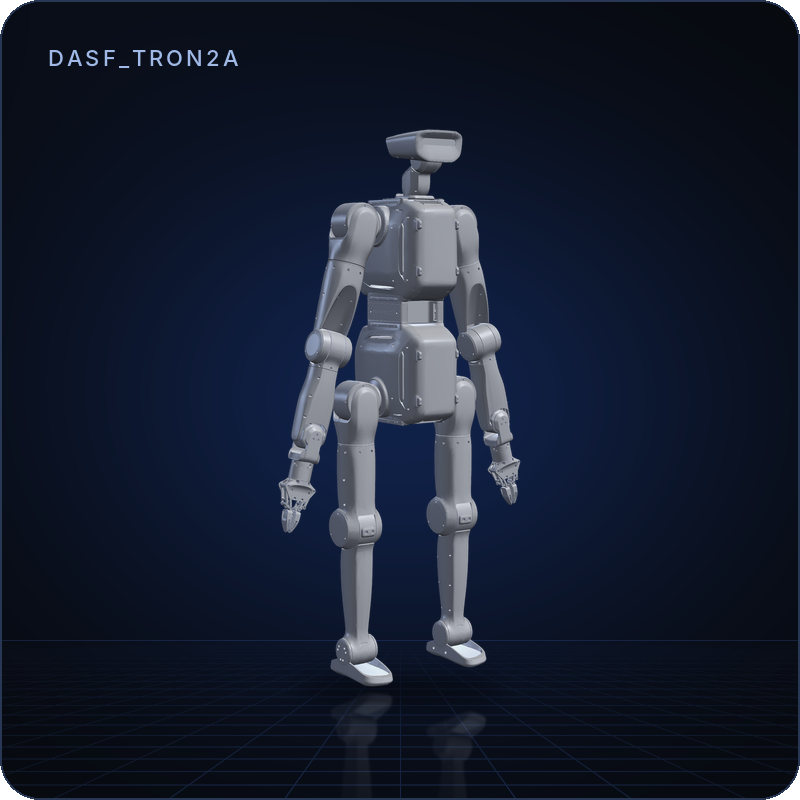 | **DASF_TRON2A** | SF 双足 + 双臂 + 头部。20 维位置动作；6 个手腕 / 头部关节由 PD 保持。<br>`Isaac-Limx-DASF-TRON2A-Blind-Flat-v0` | 26 | USD · URDF · Xacro · MJCF |

图片由 MuJoCo 根据各形态自带的机器人模型
（`exts/bipedal_locomotion/bipedal_locomotion/assets/usd/<MODEL>/`）渲染，
三者使用相同的相机和灯光。每个任务都有对应的 `-Play-v0` 版本（例如
`Isaac-Limx-SF-TRON2A-Blind-Flat-Play-v0`）。

DASF_TRON2A 的动作向量按固定顺序拼接 10 个下半身和 10 个上半身关节目标；
实机部署必须使用相同顺序。另见
[DASF_TRON2A 任务说明](exts/bipedal_locomotion/bipedal_locomotion/tasks/locomotion/cfg/DASF_TRON2A/README.md)。

<p align="center">
  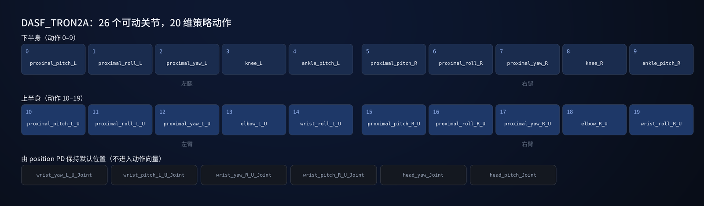
</p>

## 实机与仿真效果

**TRON2A 实机**（SF / WF / DASF_TRON2A，办公室场景）：

<p align="center">
  
  
  
</p>

**MuJoCo**（SF / WF / DASF_TRON2A）：

<p align="center">
  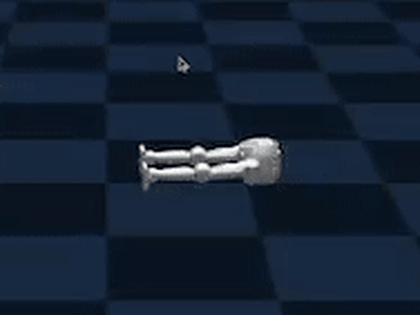
  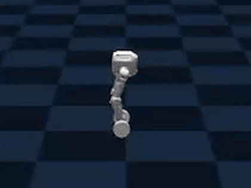
  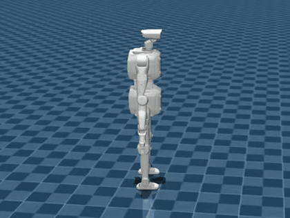
</p>

**Gazebo**（SF / WF）：

<p align="center">
  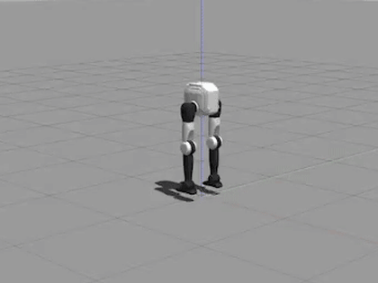
  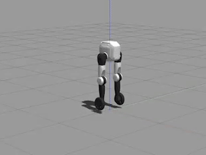
</p>

## 工作原理

<p align="center">
  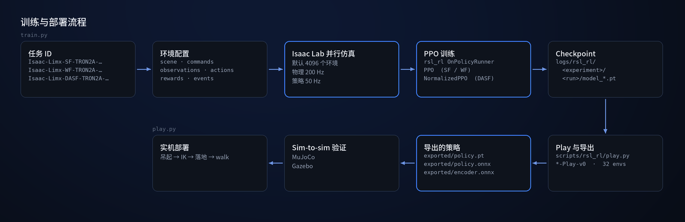
</p>

任务 ID 决定使用哪套环境配置和 PPO 配置。Isaac Lab 并行运行数千个环境
（物理 200 Hz、策略 50 Hz），`rsl_rl` 负责训练，`play.py` 导出策略，用于
sim-to-sim 验证和实机部署。

<p align="center">
  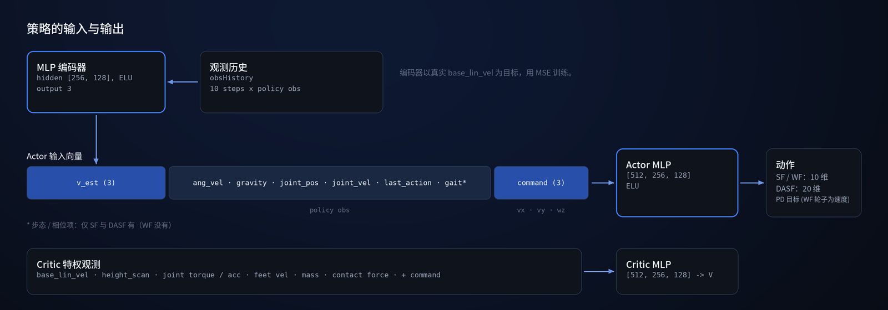
</p>

Actor 只使用本体感知、速度指令和编码器给出的机身速度估计。Critic 额外获得
仿真特权状态（真实机身速度、高度扫描、关节力矩、接触力、质量），这些信息
只在训练时可用。

## 快速开始

**30 秒看到机器人**（不需要 Isaac Sim）：

```bash
git clone https://github.com/limxdynamics/tron2_rl_lab.git
cd tron2_rl_lab
git lfs pull   # DASF_TRON2A 的 mesh 使用 Git LFS 存储
pip install mujoco
python -m mujoco.viewer --mjcf=exts/bipedal_locomotion/bipedal_locomotion/assets/usd/DASF_TRON2A/xml/robot.xml
```

把 `DASF_TRON2A` 换成 `WF_TRON2A` 即可查看轮足模型。

**训练策略**（需已安装 Isaac Sim 5.1 + Isaac Lab 2.3.1，见 [安装](#安装)）：

```bash
python scripts/rsl_rl/train.py --task Isaac-Limx-SF-TRON2A-Blind-Flat-v0 --num_envs 4096 --headless
```

## 安装

环境要求：

- **Isaac Sim 5.1** + **Isaac Lab 2.3.1**，需自行从 NVIDIA 获取（见 [适用范围](#适用范围)）
- Python 3.10
- CUDA 兼容 GPU（4096 envs 训练推荐 ≥ 12 GB 显存）

```bash
# 1. clone 仓库
git clone https://github.com/limxdynamics/tron2_rl_lab.git tron2_rl_lab
cd tron2_rl_lab

# 2. editable install extension 与 vendored rsl_rl
pip install -e exts/bipedal_locomotion
pip install -e rsl_rl
```

## 训练、推理与续训

将 `<TASK>` 替换为 [型号一览](#型号一览) 中的任务 ID。任务 ID 均在
[exts/bipedal_locomotion/bipedal_locomotion/tasks/locomotion/robots/__init__.py](exts/bipedal_locomotion/bipedal_locomotion/tasks/locomotion/robots/__init__.py) 中注册。

**训练：**

```bash
python scripts/rsl_rl/train.py --task <TASK> --num_envs 4096 --headless
```

常用选项：`--video` 开启录像，`--max_iterations N` 覆盖最大迭代数。日志与
checkpoint 保存在 `logs/rsl_rl/<experiment_name>/<timestamp>_<run_name>/`。

**推理与导出（Play）：** 使用带 `-Play-v0` 后缀的任务 ID。Play cfg 使用更少
env、关闭域随机化、简化地形。

```bash
python scripts/rsl_rl/play.py --task <TASK-with-Play-v0> --num_envs 32
```

默认加载最新 checkpoint，指定文件可用 `--checkpoint_path <path_to_model.pt>`。
Play 同时会把加载的策略导出到 checkpoint 旁的 `exported/` 目录：
`policy.pt`（TorchScript）、`policy.onnx` 和 `encoder.onnx`。DASF_TRON2A
导出的 actor 已包含观测归一化。

**续训（Resume）：** 必须显式带 `--resume True` 才会加载 checkpoint。可直接给
`.pt` 路径（推荐），或按 run 名查找：

```bash
python scripts/rsl_rl/train.py --task <TASK> --resume True --checkpoint_path <path_to_model.pt>
python scripts/rsl_rl/train.py --task <TASK> --resume True --load_run <run_name>
```

## 仓库结构与任务配置流程

```
.
├── exts/bipedal_locomotion/   # Isaac Lab extension：env/asset/MDP/robot cfg，
│                              # 机器人模型位于 bipedal_locomotion/assets/usd/
├── rsl_rl/                    # 项目内 vendored 的 rsl_rl fork（PPO + on-policy runner），
│                              # scripts/rsl_rl/train.py 优先加载此路径
├── scripts/rsl_rl/            # 训练 / play 入口（train.py / play.py / cli_args.py）
├── doc/                       # README 图片及 MuJoCo / Gazebo / 实机 GIF
└── logs/                      # 训练日志与模型权重（不提交）
```

任务 ID 的装配流程：

1. **Gym 注册**：在 `tasks/locomotion/robots/__init__.py` 中将环境配置与 PPO 配置绑定到任务 ID。
2. **环境配置 (Env cfg)**：SF/WF 分别使用
   `tasks/locomotion/robots/limx_solefoot_tron2a_env_cfg.py` 和
   `tasks/locomotion/robots/limx_wheelfoot_tron2a_env_cfg.py`；
   DASF_TRON2A 使用
   `tasks/locomotion/robots/limx_dasf_tron2a_env_cfg.py` 装配独立环境。
3. **资产配置 (Asset cfg)**：SF/WF 使用
   `assets/config/solefoot_tron2a_cfg.py` /
   `assets/config/wheelfoot_tron2a_cfg.py`；DASF_TRON2A 通过
   `assets/config/dasf_tron2a_cfg.py` 加载独立 USD 和执行器参数。
4. **DASF_TRON2A MDP**：scene、observation、event、curriculum 和 reward 位于
   `tasks/locomotion/cfg/DASF_TRON2A/`。
5. **DASF_TRON2A agent**：`tasks/locomotion/agents/dasf_rsl_rl_ppo_cfg.py` 使用
   `NormalizedPPO`、history encoder 和独立 actor/critic normalization。

## 仿真验证与实机部署

| | 仿真 | 实机部署 |
|---|---|---|
| MuJoCo + Python | [tron2_mujoco_sim](https://github.com/limxdynamics/tron2_mujoco_sim) | [tron2_rl_deploy_python](https://github.com/limxdynamics/tron2_rl_deploy_python) |
| Gazebo + ROS（SF / WF） | [tron2_gazebo_ros](https://github.com/limxdynamics/tron2_gazebo_ros) | [tron2_rl_deploy_ros](https://github.com/limxdynamics/tron2_rl_deploy_ros) |

## 实机运行注意事项（强烈建议）

<p align="center">
  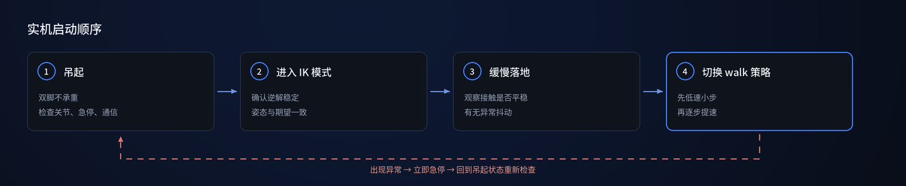
</p>

启动与落地流程建议固定为以下顺序，避免切策略瞬间冲击：

1. **将机器人吊起**，确保双脚不承重，先检查关节状态、急停和通信是否正常。
2. **先进入 IK 模式**，确认逆解控制稳定、姿态与期望一致。
3. **再缓慢将机器人放到地面**，观察接触是否平稳、是否出现异常抖动。
4. **最后切换到 walk 策略**，先低速小步验证，再逐步提升速度与动作幅度。

如出现异常（突发抖动、姿态发散、落地后冲击过大），请立即急停并回到吊起状态重新检查。

## 参与贡献

与 CI 一致的本地检查命令及简短的端到端冒烟训练，见
[CONTRIBUTING.md](CONTRIBUTING.md#verification-before-opening-a-pr)。

## 适用范围

**不包含** — 有意为之：

- **不含训练后的策略**（`*.pt`、`*.pth`、`*.ckpt`、`*.onnx`、
  `*.jit`）。请自行训练。
- **不含训练日志、TensorBoard events 或 Weights & Biases 记录。**
  `logs/`、`wandb/`、`events.out.tfevents.*` 均被 `.gitignore`
  屏蔽并在 CI 中拦截。
- **不含 Isaac Sim 的再分发。** 必须自行从 NVIDIA 获取 Isaac Sim
  5.1 并接受 NVIDIA 专有 EULA，才可安装本训练栈。本仓库不授予
  Isaac Sim 的任何许可。
- **不含 GPU / 驱动。** 本仓库不附带驱动、CUDA 或 PyTorch wheel。
- **不含 SDK 二进制、固件、标定值、客户配置或厂商 CAD。**

## 参考资料

- [Isaac Lab](https://github.com/isaac-sim/IsaacLab)
- [RSL-RL](https://github.com/leggedrobotics/rsl_rl) — 内嵌 fork
  [`rsl_rl/`](rsl_rl) 的上游。

## 许可与归属

本项目遵循 **Apache License, Version 2.0**（2004 年 1 月）发布。完整
许可文本位于仓库根目录 [`LICENSE`](LICENSE)。SPDX 标识符：`Apache-2.0`。

- [`NOTICE`](NOTICE) — 必需的归属声明。
- [`THIRD_PARTY_NOTICES.md`](THIRD_PARTY_NOTICES.md) — 各组件来源
  说明：源自 Isaac Lab 的扩展、内嵌的 `rsl_rl/` fork（BSD-3-Clause）、
  开发工具的许可文本（包含一项在发布前必须分类的 GPL 条目）、
  随附的 STL / USD 资产以及文档媒体。
- [`SECURITY.md`](SECURITY.md) — 报告安全漏洞或与安全相关的
  RL / 奖励 / 终止问题的方法。
- [`CONTRIBUTING.md`](CONTRIBUTING.md) — 开发环境搭建、内嵌
  fork 的更新策略、PR 检查清单、DCO 签署。
- [`CHANGELOG.md`](CHANGELOG.md) — 发布说明及当前未解决的
  **`⚠ TO CONFIRM`** 项（首个公开 tag 的阻塞项）。

关于子目录的说明：

- `exts/bipedal_locomotion/setup.py` 声明
  `license="Apache-2.0"`，与顶层 LICENSE 保持一致。
  基于 Isaac Lab 派生的逐文件归属审计仍标记为
  `⚠ TO CONFIRM`（见 `THIRD_PARTY_NOTICES.md` §1）。
- `rsl_rl/` 是
  [`leggedrobotics/rsl_rl`](https://github.com/leggedrobotics/rsl_rl)
  的 **内嵌 fork**，遵循 **BSD-3-Clause**；保留了上游的版权声明
  （见 `THIRD_PARTY_NOTICES.md` §2 及
  `CONTRIBUTING.md#vendored-rsl_rl-update-policy`）。

对上游的本地修改摘要见
[`CHANGES_VS_UPSTREAM.md`](rsl_rl/CHANGES_VS_UPSTREAM.md) 与
[`licenses/dependencies/README.md`](rsl_rl/licenses/dependencies/README.md)。

## 引用与支持

如在学术工作或公开成果中使用本训练栈，请引用本仓库：

```
@misc{limx_tron2_rl_lab_2026,
  title  = {tron2_rl_lab: RL training stack for the LimX TRON2A bipedal robot},
  author = {LimX Dynamics},
  year   = {2026},
  howpublished = {\url{https://github.com/limxdynamics/tron2_rl_lab}}
}
```

- **Bug 反馈 / 功能建议：** [GitHub Issues](https://github.com/limxdynamics/tron2_rl_lab/issues)。
- **问题咨询 / 集成协助：** [GitHub Discussions](https://github.com/limxdynamics/tron2_rl_lab/discussions)。
- **安全漏洞报告：** 邮件 `contact@limxdynamics.com`，另见
  [`SECURITY.md`](SECURITY.md)。
- **硬件 / 实机安全事件：** 邮件 `contact@limxdynamics.com`，
  主题前缀 `[tron2_rl_lab hardware]`，请勿在公开 Issue 中提交。
- **公司 / 商务联系：** <https://www.limxdynamics.com>。
